<!--
  Perfil de Washington Gabriel. Mesmo sistema visual do portfólio ("Código → Render"):
  vazado = rascunho · sólido = entregue · verde = ao vivo.
  Os SVGs de assets/ saem de ferramentas/gerar.py; o gráfico de contribuições, de uma Action diária.
-->

&nbsp;

&nbsp;
&nbsp;

