<!--
  Perfil de Washington Gabriel. Identidade própria, "Fios de luz": o nome é tecido por fios
  e a luz âmbar corre por eles. Os SVGs de assets/ saem de ferramentas/gerar.py;
  o gráfico de contribuições, de uma Action diária.
-->

&nbsp;

&nbsp;
&nbsp;

